<picture>
  <source media="(prefers-color-scheme: dark)" srcset="assets/banner/hero-v4-dark.svg">
  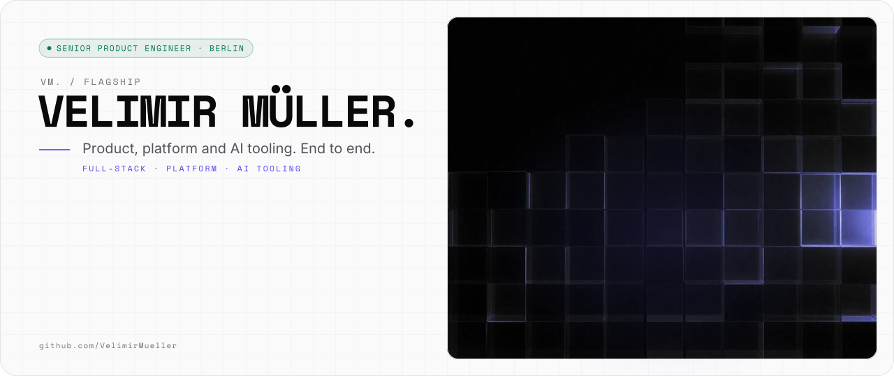
</picture>

  
  
  
  

> Models propose. Rules gate. I decide.

Senior product engineer in Berlin. I own products from requirements to release: UX, full-stack code, cloud platform and the AI tooling that speeds up delivery.

<picture>
  <source media="(prefers-color-scheme: dark)" srcset="assets/readme/stats-v4-dark.svg">
  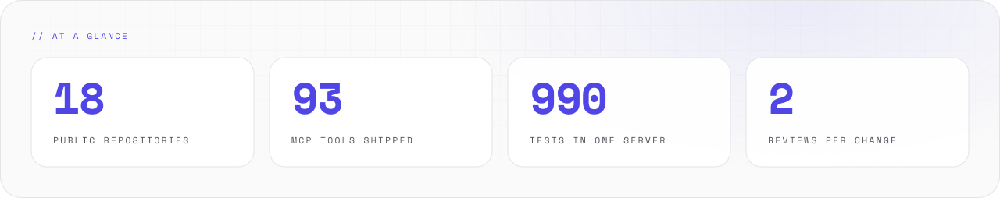
</picture>

<a href="#-01-profile">Profile</a> · <a href="#-02-experience">Experience</a> · <a href="#-03-flagships">Flagships</a> · <a href="#-04-delivery-system">Delivery system</a> · <a href="#-05-capabilities">Capabilities</a>

 

## // 01 PROFILE

<picture>
  <source media="(prefers-color-scheme: dark)" srcset="assets/readme/practice-v4-dark.svg">
  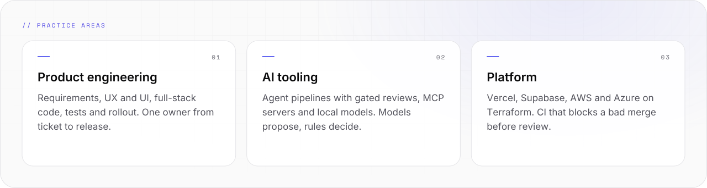
</picture>

<picture>
  <source media="(prefers-color-scheme: dark)" srcset="assets/readme/focus-v4-dark.svg">
  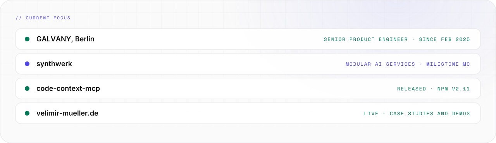
</picture>

 

## // 02 EXPERIENCE

Years of product work, from frontend specialist to full-stack product engineer. Today I plan, build and run whole applications, from the first requirement to production.

<picture>
  <source media="(prefers-color-scheme: dark)" srcset="assets/readme/ownership-v4-dark.svg">
  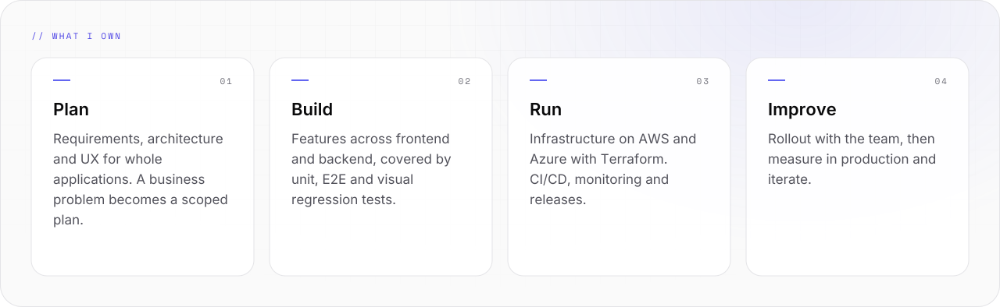
</picture>

**GALVANY** · Senior Software Engineer, Full-Stack / Product · Berlin · Feb 2025 to now

- Own product engineering end to end at a high-growth energy company.
- Planned and built the lead management platform, from data model to UI. Lead assignment is 3 to 4 times faster.
- Built the scoring engine that matches leads to sellers.
- Run the infrastructure on AWS and Azure, provisioned with Terraform.
- Ship each release with unit, E2E and visual regression tests.
- The code is private. Case studies are on [velimir-mueller.de](https://velimir-mueller.de).

 

## // 03 FLAGSHIPS

<a href="https://github.com/VelimirMueller/synthwerk">
  <picture>
    <source media="(prefers-color-scheme: dark)" srcset="assets/cards/synthwerk-v4-dark.svg">
    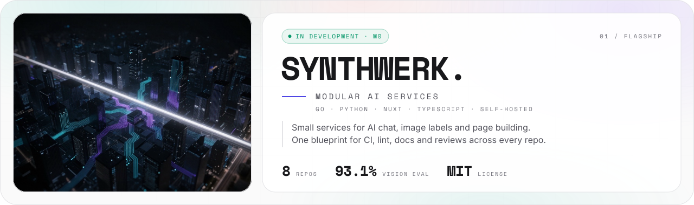
  </picture>
</a>

<a href="https://github.com/VelimirMueller/code-context-mcp">
  <picture>
    <source media="(prefers-color-scheme: dark)" srcset="assets/cards/code-context-v4-dark.svg">
    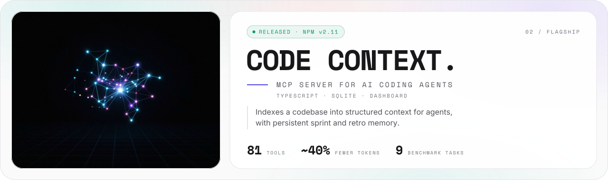
  </picture>
</a>

<a href="https://github.com/VelimirMueller/portfolio-website">
  <picture>
    <source media="(prefers-color-scheme: dark)" srcset="assets/cards/portfolio-v4-dark.svg">
    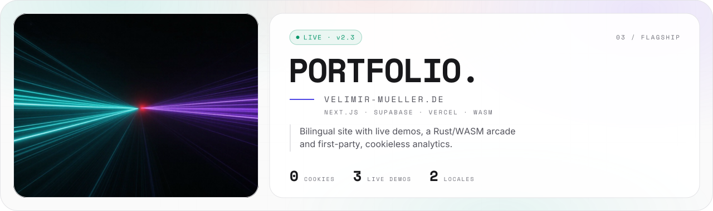
  </picture>
</a>

 

**Synthwerk** is a set of small services, one repository per role:

<picture>
  <source media="(prefers-color-scheme: dark)" srcset="assets/panels/synthwerk-map-v1-dark.svg">
  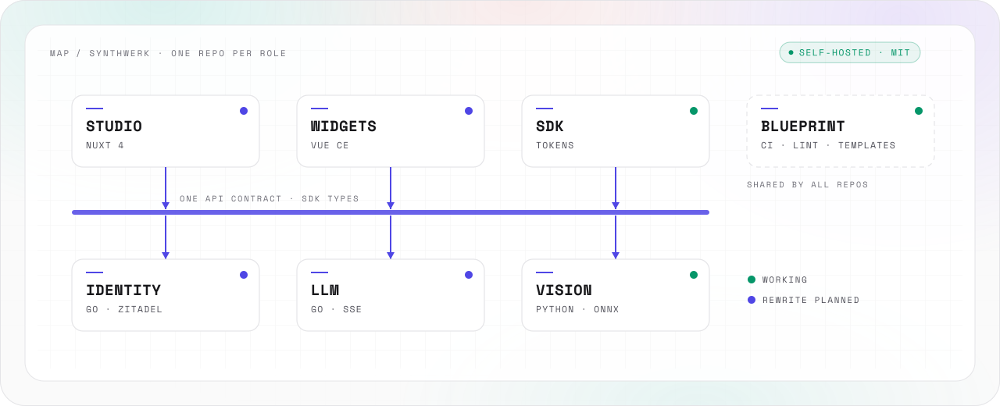
</picture>

<picture>
  <source media="(prefers-color-scheme: dark)" srcset="assets/readme/synthwerk-v4-dark.svg">
  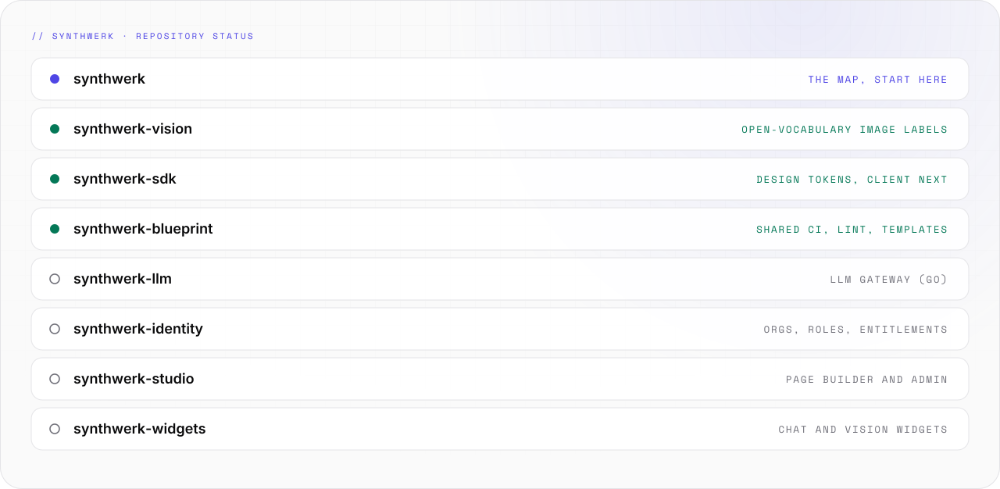
</picture>

Repositories: [synthwerk](https://github.com/VelimirMueller/synthwerk) · [vision](https://github.com/VelimirMueller/synthwerk-vision) · [sdk](https://github.com/VelimirMueller/synthwerk-sdk) · [blueprint](https://github.com/VelimirMueller/synthwerk-blueprint) · [llm](https://github.com/VelimirMueller/synthwerk-llm) · [identity](https://github.com/VelimirMueller/synthwerk-identity) · [studio](https://github.com/VelimirMueller/synthwerk-studio) · [widgets](https://github.com/VelimirMueller/synthwerk-widgets)

 

## // 04 DELIVERY SYSTEM

Every change goes through the same gated pipeline. Most of the tooling is private; this is the process at a high level.

<picture>
  <source media="(prefers-color-scheme: dark)" srcset="assets/readme/pipeline-v4-dark.svg">
   Spec -> Build -> Review -> Ship. No step merges, deploys or closes a ticket on its own. Every review finding is kept in a shared memory." src="assets/readme/pipeline-v4-light.svg" width="100%">
</picture>

<picture>
  <source media="(prefers-color-scheme: dark)" srcset="assets/readme/controls-v4-dark.svg">
  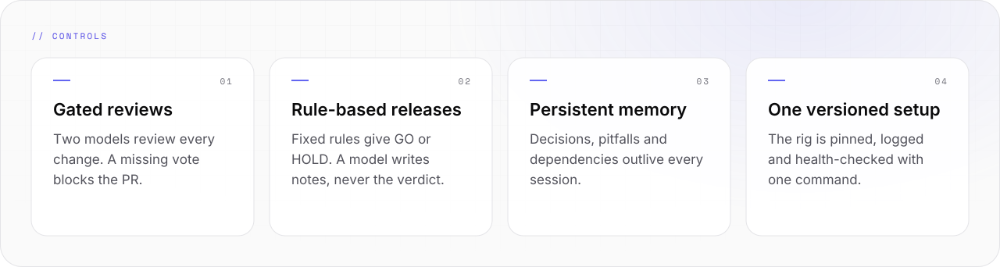
</picture>

- **Accountability.** I write the ticket, approve the spec and own the merge.
- **Independent review.** Two models review each change. Both must approve before a PR opens.
- **Release decisions by rule.** A release check reads the merged PRs. Fixed rules give GO or HOLD.
- **Local first.** Image generation, document creation and code search run on my machine.

<picture>
  <source media="(prefers-color-scheme: dark)" srcset="assets/readme/principle-v4-dark.svg">
  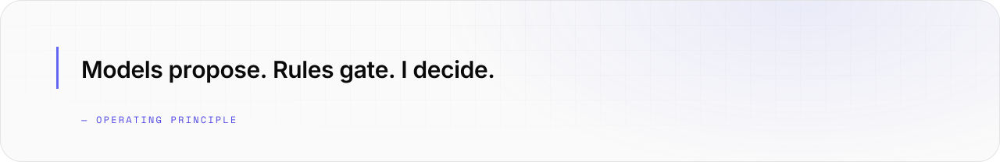
</picture>

 

## // 05 CAPABILITIES

<picture>
  <source media="(prefers-color-scheme: dark)" srcset="assets/readme/stack-v4-dark.svg">
  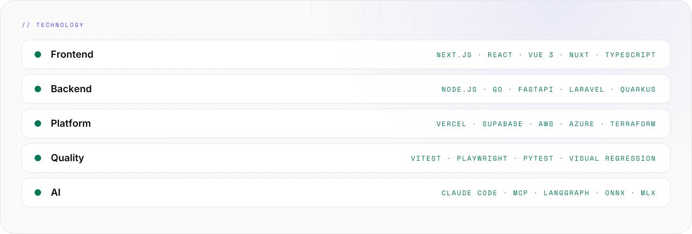
</picture>

<picture>
  <source media="(prefers-color-scheme: dark)" srcset="assets/readme/rnd-v4-dark.svg">
  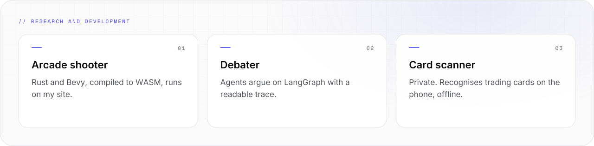
</picture>

Repositories: [claude-skills](https://github.com/VelimirMueller/claude-skills) · [lab-arcade-shooter](https://github.com/VelimirMueller/lab-arcade-shooter) · [lab-debater](https://github.com/VelimirMueller/lab-debater)

 

  <picture>
    <source media="(prefers-color-scheme: dark)" srcset="assets/logo/vm-logo-v1-dark.svg">
    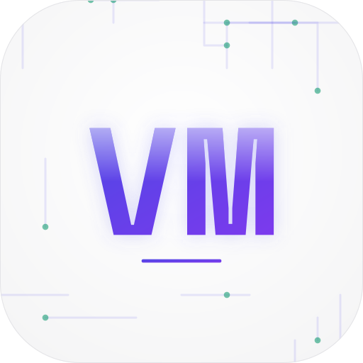
  </picture>

  <b>Velimir Müller</b> · Senior Product Engineer · Berlin 
  <a href="https://velimir-mueller.de">velimir-mueller.de</a> · <a href="https://www.linkedin.com/in/velimir-m%C3%BCller-07b460175">LinkedIn</a> · <a href="mailto:velimir.mueller@googlemail.com">Email</a>

