

<picture>
  <source media="(prefers-color-scheme: light)" srcset="assets/banner/hero-v4-light.svg">
  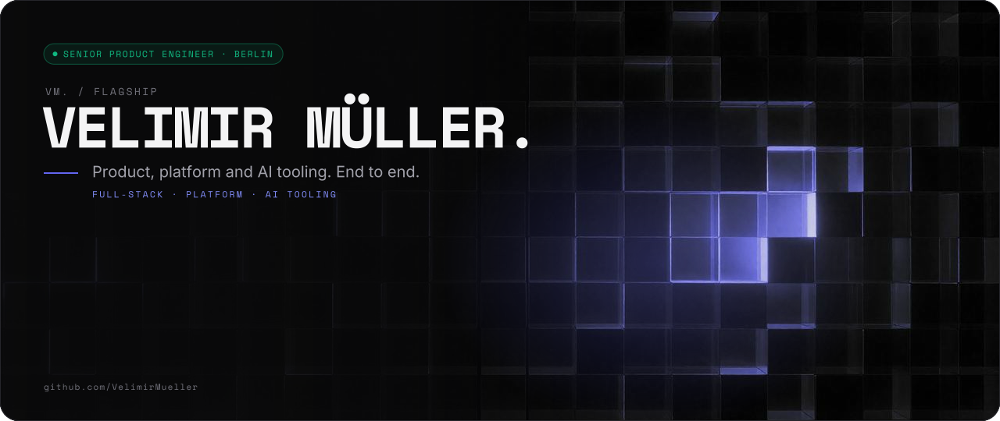
</picture>

<picture>
  <source media="(prefers-color-scheme: light)" srcset="assets/readme/about-v4-light.svg">
  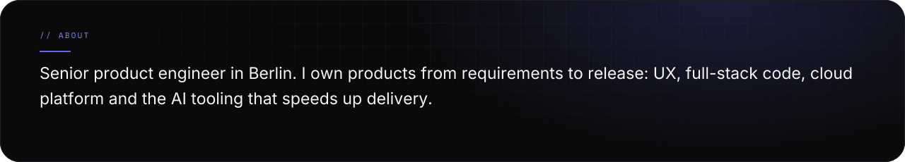
</picture>

<a href="https://velimir-mueller.de"><picture><source media="(prefers-color-scheme: light)" srcset="assets/readme/contact-1-v4-light.svg"></picture></a>
<a href="https://www.linkedin.com/in/velimir-m%C3%BCller-07b460175"><picture><source media="(prefers-color-scheme: light)" srcset="assets/readme/contact-2-v4-light.svg">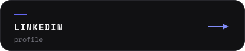</picture></a>
<a href="mailto:velimir.mueller@googlemail.com"><picture><source media="(prefers-color-scheme: light)" srcset="assets/readme/contact-3-v4-light.svg">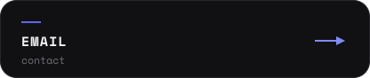</picture></a>

<picture>
  <source media="(prefers-color-scheme: light)" srcset="assets/readme/stats-v4-light.svg">
  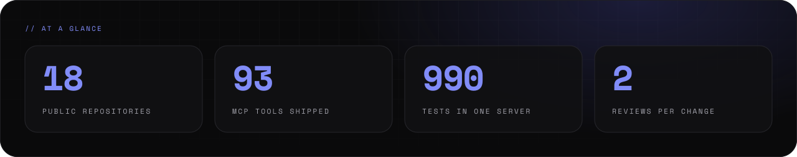
</picture>

 

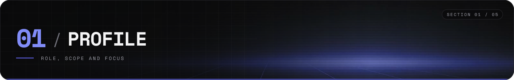

<picture>
  <source media="(prefers-color-scheme: light)" srcset="assets/readme/practice-v4-light.svg">
  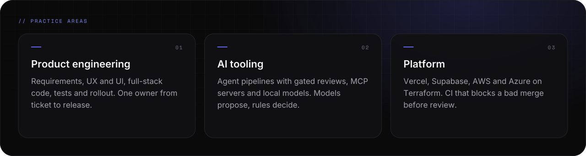
</picture>

<picture>
  <source media="(prefers-color-scheme: light)" srcset="assets/readme/focus-v4-light.svg">
  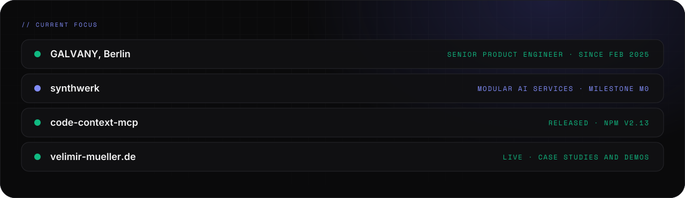
</picture>

 

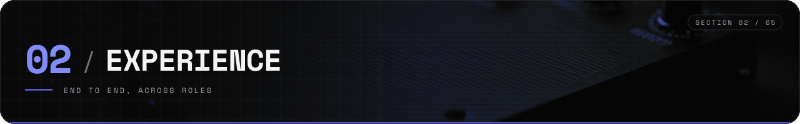

<picture>
  <source media="(prefers-color-scheme: light)" srcset="assets/readme/career-v4-light.svg">
  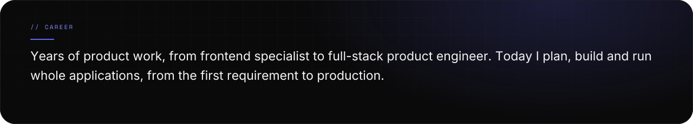
</picture>

<picture>
  <source media="(prefers-color-scheme: light)" srcset="assets/readme/ownership-v4-light.svg">
  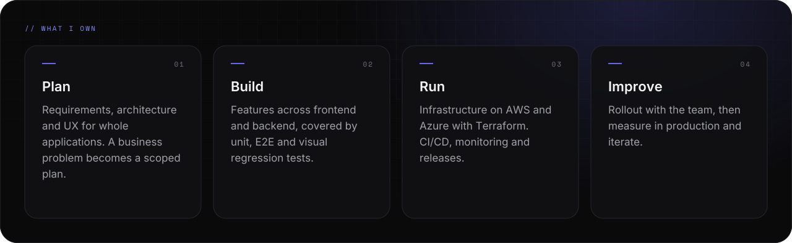
</picture>

<picture>
  <source media="(prefers-color-scheme: light)" srcset="assets/readme/role-v4-light.svg">
  
</picture>

 

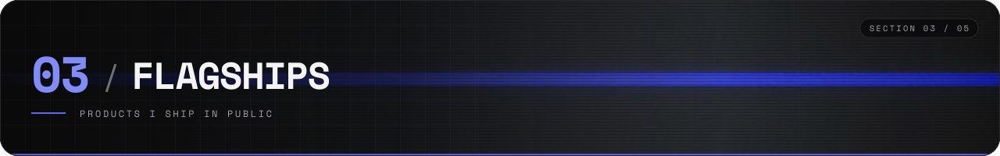

<a href="https://github.com/VelimirMueller/synthwerk">
<picture>
  <source media="(prefers-color-scheme: light)" srcset="assets/readme/flagship-synthwerk-v4-light.svg">
  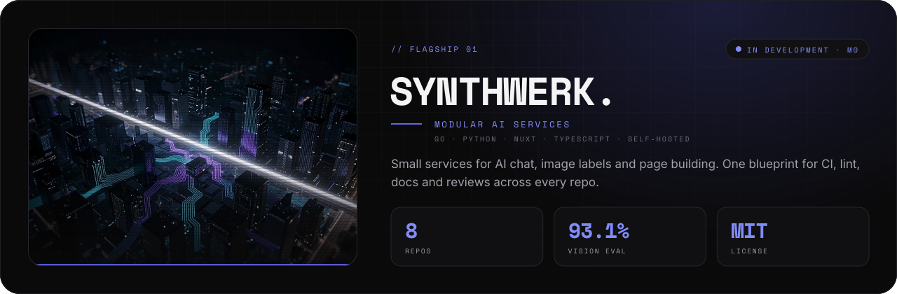
</picture>
</a>

<a href="https://github.com/VelimirMueller/code-context-mcp">
<picture>
  <source media="(prefers-color-scheme: light)" srcset="assets/readme/flagship-code-context-v4-light.svg">
  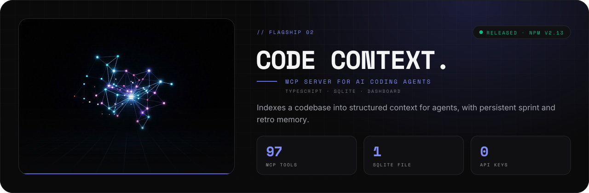
</picture>
</a>

<a href="https://github.com/VelimirMueller/portfolio-website">
<picture>
  <source media="(prefers-color-scheme: light)" srcset="assets/readme/flagship-portfolio-v4-light.svg">
  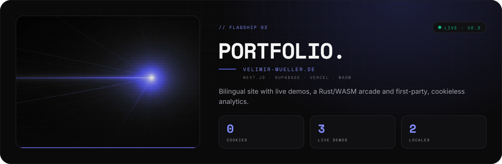
</picture>
</a>

<picture>
  <source media="(prefers-color-scheme: light)" srcset="assets/readme/synthlead-v4-light.svg">
  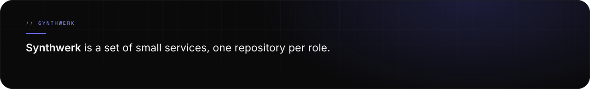
</picture>

<picture>
  <source media="(prefers-color-scheme: light)" srcset="assets/panels/synthwerk-map-v1-light.svg">
  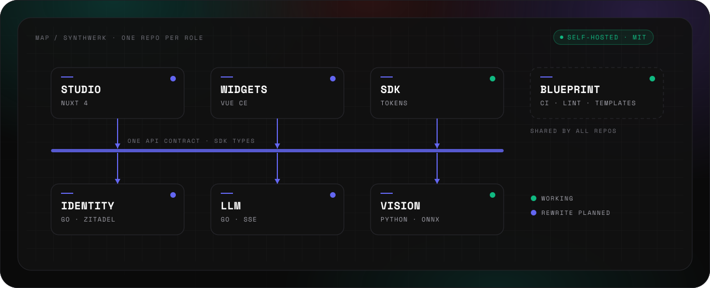
</picture>

<picture>
  <source media="(prefers-color-scheme: light)" srcset="assets/readme/synthwerk-v4-light.svg">
  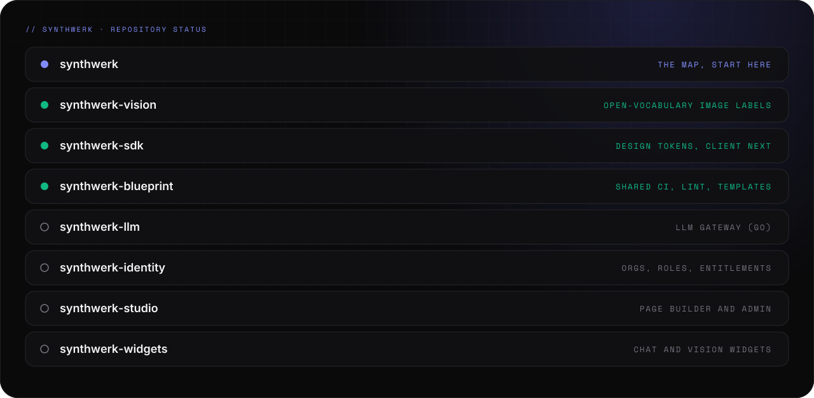
</picture>

<a href="https://github.com/VelimirMueller/synthwerk"><picture><source media="(prefers-color-scheme: light)" srcset="assets/readme/synthrepos-1-v4-light.svg">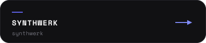</picture></a>
<a href="https://github.com/VelimirMueller/synthwerk-vision"><picture><source media="(prefers-color-scheme: light)" srcset="assets/readme/synthrepos-2-v4-light.svg">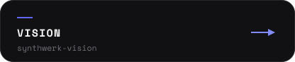</picture></a>
<a href="https://github.com/VelimirMueller/synthwerk-sdk"><picture><source media="(prefers-color-scheme: light)" srcset="assets/readme/synthrepos-3-v4-light.svg">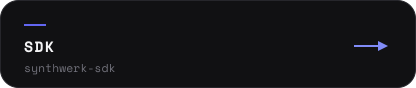</picture></a>

<a href="https://github.com/VelimirMueller/synthwerk-blueprint"><picture><source media="(prefers-color-scheme: light)" srcset="assets/readme/synthrepos-4-v4-light.svg">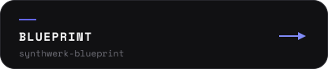</picture></a>
<a href="https://github.com/VelimirMueller/synthwerk-llm"><picture><source media="(prefers-color-scheme: light)" srcset="assets/readme/synthrepos-5-v4-light.svg">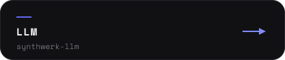</picture></a>
<a href="https://github.com/VelimirMueller/synthwerk-identity"><picture><source media="(prefers-color-scheme: light)" srcset="assets/readme/synthrepos-6-v4-light.svg">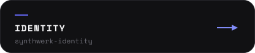</picture></a>

<a href="https://github.com/VelimirMueller/synthwerk-studio"><picture><source media="(prefers-color-scheme: light)" srcset="assets/readme/synthrepos-7-v4-light.svg"></picture></a>
<a href="https://github.com/VelimirMueller/synthwerk-widgets"><picture><source media="(prefers-color-scheme: light)" srcset="assets/readme/synthrepos-8-v4-light.svg">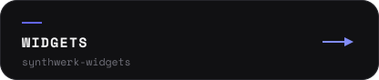</picture></a>

 

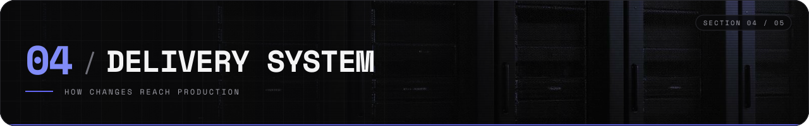

<picture>
  <source media="(prefers-color-scheme: light)" srcset="assets/readme/process-v4-light.svg">
  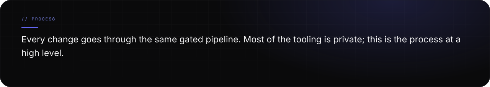
</picture>

<picture>
  <source media="(prefers-color-scheme: light)" srcset="assets/readme/pipeline-v4-light.svg">
  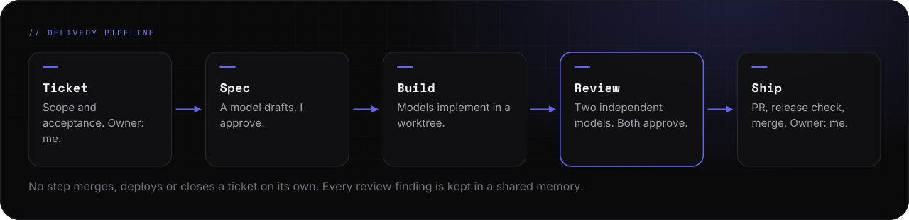
</picture>

<picture>
  <source media="(prefers-color-scheme: light)" srcset="assets/readme/controls-v4-light.svg">
  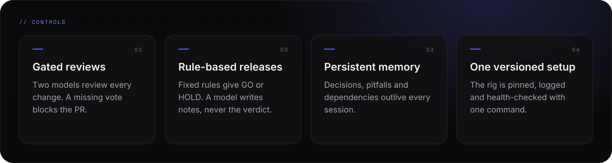
</picture>

<picture>
  <source media="(prefers-color-scheme: light)" srcset="assets/readme/rules-v4-light.svg">
  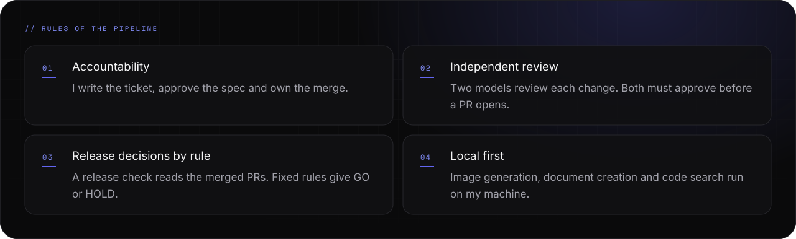
</picture>

<picture>
  <source media="(prefers-color-scheme: light)" srcset="assets/readme/principle-v4-light.svg">
  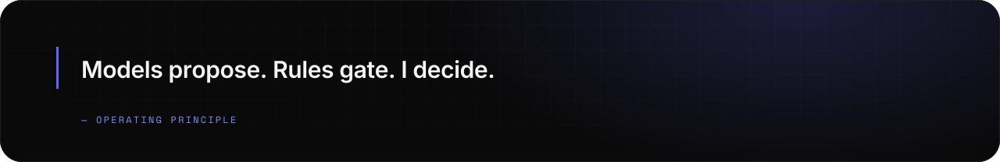
</picture>

 

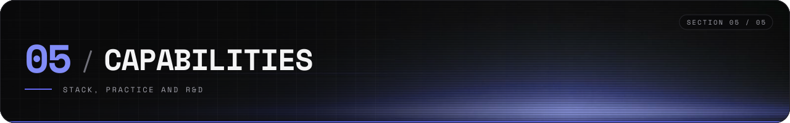

<picture>
  <source media="(prefers-color-scheme: light)" srcset="assets/readme/stack-v4-light.svg">
  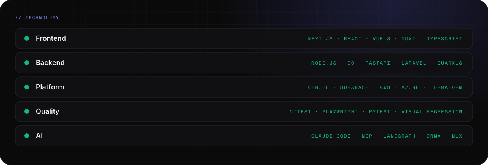
</picture>

<picture>
  <source media="(prefers-color-scheme: light)" srcset="assets/readme/rnd-v4-light.svg">
  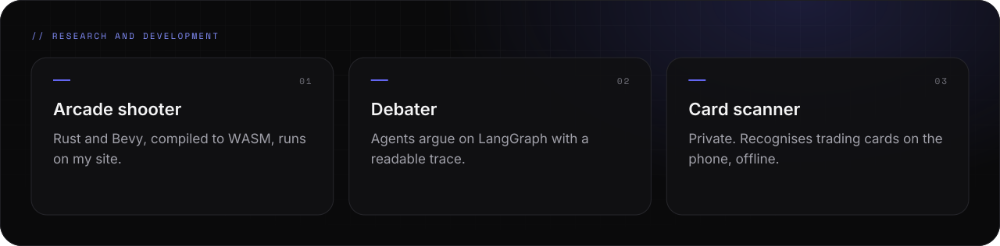
</picture>

<a href="https://github.com/VelimirMueller/claude-skills"><picture><source media="(prefers-color-scheme: light)" srcset="assets/readme/labrepos-1-v4-light.svg">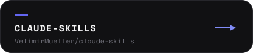</picture></a>
<a href="https://github.com/VelimirMueller/lab-arcade-shooter"><picture><source media="(prefers-color-scheme: light)" srcset="assets/readme/labrepos-2-v4-light.svg">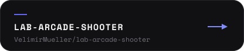</picture></a>
<a href="https://github.com/VelimirMueller/lab-debater"><picture><source media="(prefers-color-scheme: light)" srcset="assets/readme/labrepos-3-v4-light.svg">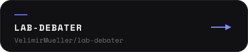</picture></a>

<picture>
  <source media="(prefers-color-scheme: light)" srcset="assets/logo/vm-logo-v2-light.svg">
  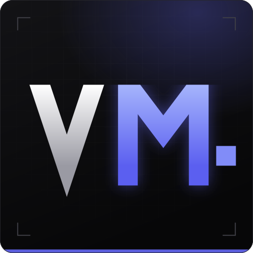
</picture>

<a href="https://velimir-mueller.de"><picture><source media="(prefers-color-scheme: light)" srcset="assets/readme/contact-1-v4-light.svg"></picture></a>
<a href="https://www.linkedin.com/in/velimir-m%C3%BCller-07b460175"><picture><source media="(prefers-color-scheme: light)" srcset="assets/readme/contact-2-v4-light.svg"></picture></a>
<a href="mailto:velimir.mueller@googlemail.com"><picture><source media="(prefers-color-scheme: light)" srcset="assets/readme/contact-3-v4-light.svg"></picture></a>

<picture>
  <source media="(prefers-color-scheme: light)" srcset="assets/readme/footer-v4-light.svg">
  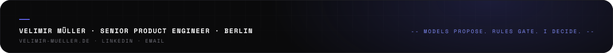
</picture>

